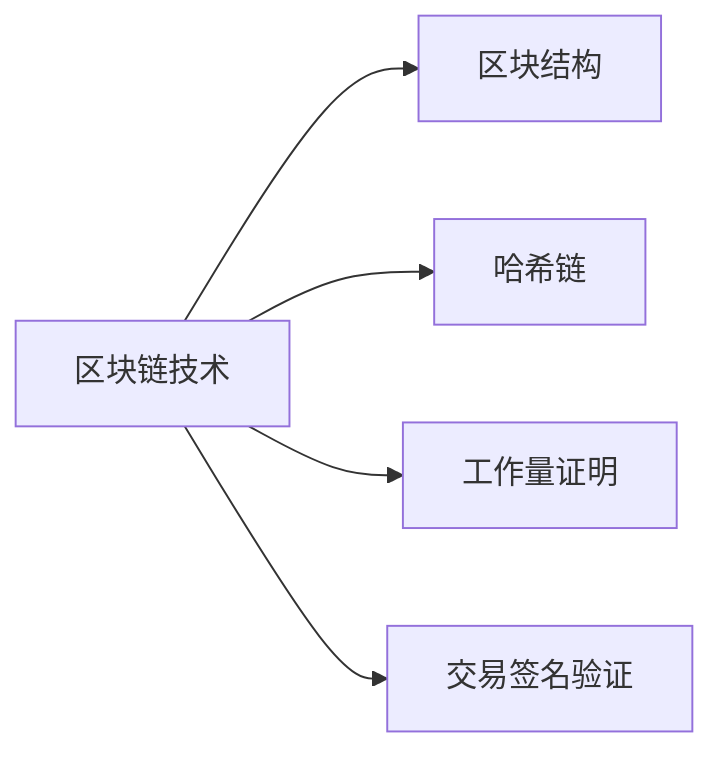

# 区块链技术相关学习——比特币系统实现

## 一、目标：
  - 1.实现什么功能：
    实现一个简易的区块链演示系统，包含核心密码学组件（哈希链、数字签名、共识机制），并利用AI辅助生成代码和分析安全性。 
  - 2.需要实现的核心功能：
    区块链核心实现：区块结构、哈希链、工作量证明（PoW）、交易签名验证 - AI辅助生成区块链核心代码，人工审查并修复AI生成代码中的安全缺陷 - 安全分析：利用AI分析区块链系统的安全性，识别潜在攻击向量（51%攻击、双花攻击、时间戳篡改等） - 攻击模拟：实现至少一种攻击的模拟演示，并展示对应的防御措施
  - 3.推荐使用的密码学技术：
    SHA-256哈希（区块链接）(blake3)、ECDSA或RSA数字签名（交易签名）、PoW共识机制、Merkle树（可选）、区块链攻击模型
  - 4.达到什么效果：
    运行一个简易的区块链节点，支持创建交易、挖矿、验证链的完整性。演示时展示区块链的不可篡改性（尝试修改历史区块后链被拒绝），模拟51%攻击或双花攻击并展示防御措施。同时展示AI辅助生成代码的过程记录和AI安全分析的发现。

## 二、项目蓝图：

<br>

 ```mermaid
graph LR
    B[比特币系统] --> b1[密码学基础]
      b1 --> b1_1[非对称加密<br/>椭圆曲线 secp256k1]
      b1 --> b1_2[哈希函数 SHA-256]
        b1_2 --> b1_2_1[数据完整性]
        b1_2 --> b1_2_2[工作量证明 PoW]
        b1_2 --> b1_2_3[Merkle Tree<br/>默克尔根]
    B --> b2[点对点网络 P2P]
      b2 --> b2_1[节点类型]
        b2_1 --> b2_1_1[全节点 Full Node]
        b2_1 --> b2_1_2[轻节点 SPV]
        b2_1 --> b2_1_3[挖矿节点 Miner]
      b2 --> b2_2[Gossip 协议]
      b2 --> b2_3[抗审查性]

    B --> b5[数据结构与账本 Blockchain]
      b5 --> b5_1[区块头 Block Header]
      b5 --> b5_2[区块体 Transactions]
      b5 --> b5_3[UTXO 模型]

    B --> b3[共识机制 Consensus]
      b3 --> b3_1[工作量证明 PoW]
      b3 --> b3_2[最长链原则]
      b3 --> b3_3[难度调整]

    B --> b4[脚本系统与激励机制]
      b4 --> b4_1[比特币脚本 Script]
      b4 --> b4_2[经济激励]
        b4_2 --> b4_2_1[区块奖励]
        b4_2 --> b4_2_2[交易手续费]
        b4_2 --> b4_2_3[安全绑定作用]

  ```